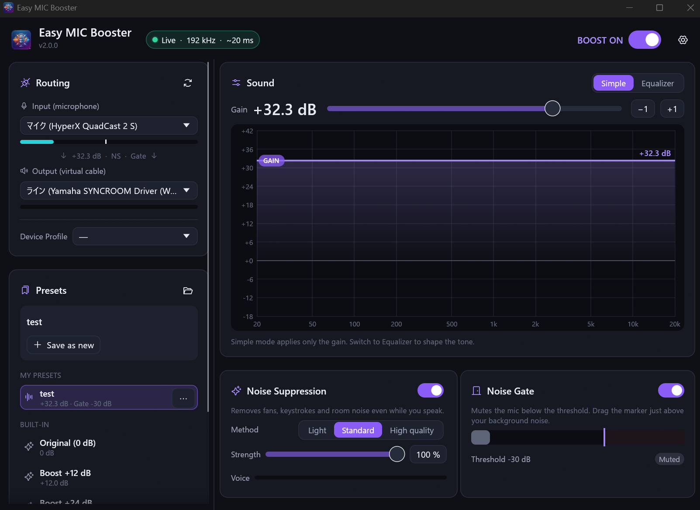

# Easy MIC Booster

Amplificación de la ganancia del micrófono y procesamiento de audio de alta calidad para Windows.
{: .fs-6 .fw-300 }

Captura su micrófono, lo limpia y lo amplifica (supresión de ruido, ecualizador, ganancia, puerta de ruido y limitador) y envía el resultado a un dispositivo de audio virtual como VB-CABLE, de modo que todas las aplicaciones reciban la voz procesada.

[Comenzar](user-guide){: .btn .btn-primary .fs-5 .mb-4 .mb-md-0 .mr-2 }
[Descargar](https://github.com/SeiyaFunaokaJP/Easy-MIC-Booster/releases/latest){: .btn .fs-5 .mb-4 .mb-md-0 .mr-2 }
[GitHub](https://github.com/SeiyaFunaokaJP/Easy-MIC-Booster){: .btn .fs-5 .mb-4 .mb-md-0 }



---

## Características principales {#key-features}

- **Amplificador por software** -- amplifica un micrófono débil más allá del límite de ganancia de Windows (hasta +50 dB, o +100 dB si se desbloquea)
- **Supresión de ruido** -- elimina ventiladores, tecleo y ruido ambiente incluso mientras habla; elija Ligero, Estándar (RNNoise) o Alta calidad (DeepFilterNet3)
- **Ecualizador paramétrico** -- moldee su tono sobre un gráfico de espectro en tiempo real
- **Puerta de ruido** -- silencia el micrófono entre frases para que las pausas queden totalmente en silencio
- **Limitador** -- mantiene los picos por debajo de un techo para que los sonidos fuertes repentinos nunca saturen
- **Preajustes y perfiles de dispositivos** -- cambie de sonido y de pareja micrófono/salida con un solo clic
- **Control desde la bandeja** -- sigue funcionando en el área de notificación; el boost, los preajustes y los dispositivos están a un clic derecho
- **8 idiomas** -- English, 日本語, 简体中文, 繁體中文, 한국어, Deutsch, Français, Español

## Cómo funciona {#how-it-works}

```
Micrófono
    │
    ▼
Captura (WASAPI en Windows)
    │
    ▼
Supresión de ruido → Ecualizador → Ganancia → Puerta de ruido → Limitador
    │
    ▼
Dispositivo de audio virtual (p. ej., CABLE Input)
    │
    ▼
Discord / Zoom / OBS / Teams / juegos …
```

## Inicio rápido {#quick-start}

1. Instale [VB-CABLE](https://vb-audio.com/Cable/).
2. Descargue la última versión (el instalador `...-setup.exe` o el zip portable) e inicie Easy MIC Booster.
3. En **Enrutamiento**, elija su micrófono como **Entrada** y `CABLE Input (VB-Audio Virtual Cable)` como **Salida**.
4. Asegúrese de que **BOOST ON** esté activado en la esquina superior derecha y ajuste la **Ganancia**.
5. En Discord, Zoom, OBS, etc., seleccione `CABLE Output (VB-Audio Virtual Cable)` como micrófono.

Consulte la [Guía del usuario](user-guide) para ver el procedimiento completo.
